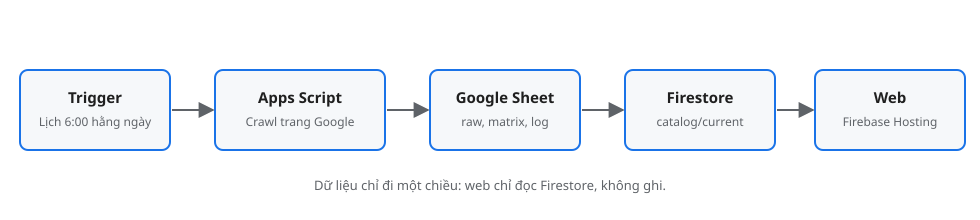

# GWS Compare

So sánh tính năng giữa các edition của Google Workspace trong một bảng duy nhất, có bộ lọc, chú thích và xuất CSV.

Trang công khai: https://phienbangws.web.app



## Vấn đề

Trang so sánh edition của Google nằm rải rác nhiều trang, mỗi family một trang, và khó lọc theo từng tính năng. Dự án gom các trang đó thành một ma trận: mỗi dòng là một tính năng, mỗi cột là một edition.

## Cách hoạt động

1. Apps Script chạy mỗi sáng và crawl các trang của Google.
2. Kết quả được ghi vào Google Sheet để kiểm tra.
3. Script đẩy dữ liệu đã đổi lên Firestore.
4. Web đọc Firestore và hiển thị. Chỉ tải lại các section có thay đổi.

Dữ liệu chỉ đọc từ phía người dùng. Mọi ghi dữ liệu đều đi qua Apps Script.

## Tính năng web

- Lọc theo family, edition, section, từ khóa.
- Chỉ hiện các dòng khác nhau giữa các edition đang chọn.
- Sắp xếp theo cột.
- Ký hiệu có tick và x, bấm vào ký hiệu `*` để xem chú thích.
- Tải CSV theo đúng kết quả đang lọc.

## Cấu trúc

```
apps-script/   Code.gs và appsscript.json (crawl, ghi Sheet, đẩy Firestore)
web/           Ứng dụng Vite, JS thuần, dùng Firebase
firestore.rules  Quy tắc: ai cũng đọc được catalog, không ai ghi từ client
firebase.json  Cấu hình Hosting và Firestore
CLAUDE.md      Ghi chú bàn giao và quy tắc làm việc
```

## Chạy cục bộ

```bash
cd web
cp .env.example .env.local   # điền giá trị từ Firebase console
npm install
npm run dev
```

Biến môi trường nằm trong `web/.env.example`. File `.env.local` không được commit.

## Deploy

```bash
cd web && npm run build
cd .. && firebase deploy --only hosting
```

Quy tắc Firestore deploy riêng bằng `firebase deploy --only firestore:rules`.

## Lưu ý

- Đây là trang cá nhân, không phải trang chính thức của Google. Luôn kiểm tra lại tại trang chính thức của Google Workspace.
- Một số dữ liệu còn thiếu, xem mục "Nợ dữ liệu" trong `CLAUDE.md`.
- Chưa xác nhận được quyền đăng lại công khai nội dung của Google.
